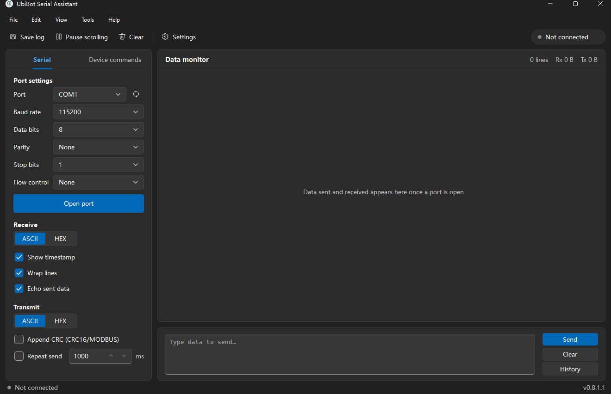
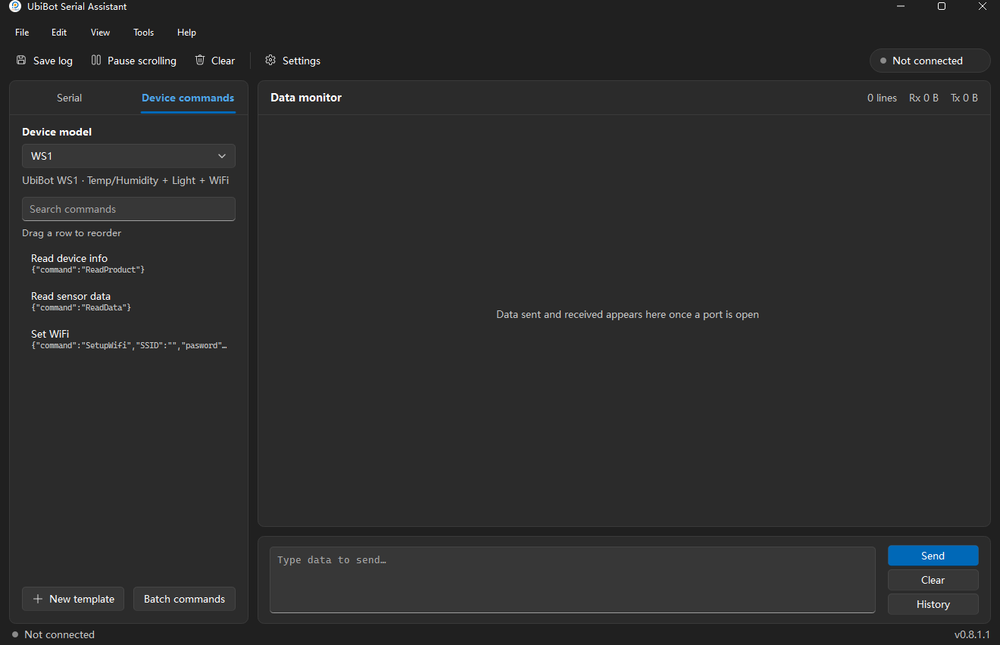
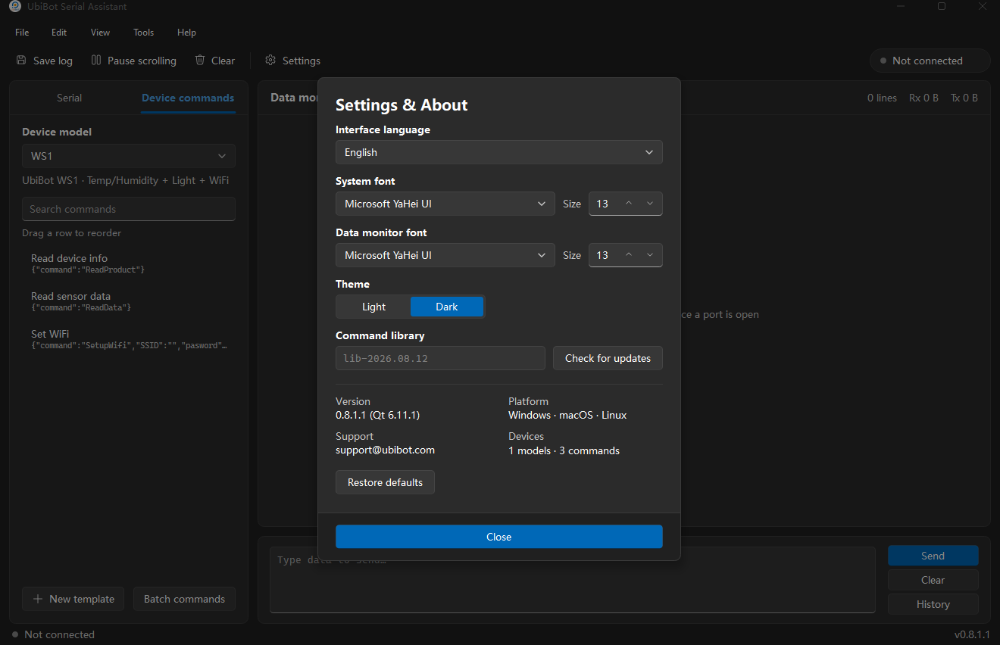

# UbiBot Serial Assistant

A cross-platform, lightweight desktop serial-port tool built with Qt 6
Widgets and C++17 — fully open-source and free. Purpose-built and optimized
for UbiBot IoT devices (WS1, WS1 Pro, GS1-AL4G1RS, SP1, …), with
cloud-synced UbiBot device commands so new devices don't require a new app
build to reach people who already have it installed.

The UI is a native Fluent-style Qt Widgets desktop app built on the vendored
QLight widget library — not QML, and not a bundled browser runtime. It uses a
frameless custom window, starts in dark mode on first run, and keeps the data
monitor and send box visible while the left-hand panel switches between
serial settings and the device command library.

## Download

Pre-built, self-contained packages — no Qt install, nothing else needed —
are published on the [Releases page](https://github.com/ubibot-open/ubibot-serial-sync/releases).
These links always resolve to the newest build:

| Platform | Download |
|---|---|
| Windows | [UbiBotSerialAssistant-windows-x64-setup.exe](https://github.com/ubibot-open/ubibot-serial-sync/releases/latest/download/UbiBotSerialAssistant-windows-x64-setup.exe) — installer, no admin rights needed |
| Windows (portable) | [UbiBotSerialAssistant-windows-x64.zip](https://github.com/ubibot-open/ubibot-serial-sync/releases/latest/download/UbiBotSerialAssistant-windows-x64.zip) — unzip anywhere and run the `.exe` inside |
| macOS | [UbiBotSerialAssistant-macos.dmg](https://github.com/ubibot-open/ubibot-serial-sync/releases/latest/download/UbiBotSerialAssistant-macos.dmg) |
| Linux | [UbiBotSerialAssistant-linux-x86_64.AppImage](https://github.com/ubibot-open/ubibot-serial-sync/releases/latest/download/UbiBotSerialAssistant-linux-x86_64.AppImage) (`chmod +x`, then run — no install needed) |

The Windows installer puts the app in `%LOCALAPPDATA%\Programs\UbiBot Serial
Assistant` (per user, so no UAC prompt), adds a Start Menu shortcut, and
registers an uninstaller in "Apps & features". Installing per user is
deliberate: the installation directory stays writable by you, which is what
the in-app updater (`Help → Check for software update`) needs to replace files
without elevation. The portable `.zip` is the same build with no shortcuts and
works from any folder.

Windows requirements: **Windows 10 (version 1703 or later)** — Qt 6 itself
wants 1809+, and the app needs the system ICU library `icu.dll` that ships
with 1703+. Older systems now get a plain "requires a newer version of
Windows" from the loader rather than a baffling missing-DLL error, and the
installer checks the same thing up front. The packages carry the MSVC
runtime (`msvcp140*.dll`, `vcruntime140*.dll`) next to the `.exe`, so
installing the Visual C++ redistributable separately is not required.

Neither the Windows `.exe` nor the macOS `.app`/`.dmg` is code-signed, so first
run triggers a stock "unknown publisher" warning from SmartScreen/Gatekeeper
— click through it (or right-click → Open on macOS) same as any other
unsigned open-source binary.

**Building from source is not required to use this app** — see
[BUILD.md](BUILD.md) only if you want to build it yourself, extend it, or
understand how it's put together internally.

## User interface

The window is a single frameless, custom-drawn title bar and window frame
(QLight's FramelessWindow on top of QWindowKit), so the whole window — not
just its contents — follows the app's light/dark theme. First run starts in
dark mode and in the OS's UI language; both are switchable in Settings &
About.

**Serial connection settings** — port (annotated with its USB-to-serial
bridge chip when known), baud rate, data/stop bits, parity, flow control, and
an explicit Open/Close port button, followed by receive options (ASCII/HEX,
timestamps, line wrap, echo) and transmit options (ASCII/HEX, CRC16/MODBUS
append, repeat-send interval). Selecting a device model that ships
recommended serial settings applies them automatically:

**Device command library** — searchable, per-model command sets with
drag-to-reorder, an inline parameter form with a live payload preview for
commands that take arguments, your own quick-send templates, and saved
multi-step "batch commands":

**Settings & About** — runtime language switch, system and data-monitor font
pickers, light/dark theme, the device command library's own version/update
status, and app/platform/library information:

Beyond what's pictured above: a menu bar (`File`/`Edit`/`View`/`Tools`/
`Help`) and command bar (save log, pause scrolling, clear, settings) across
the top, a connection status pill, and a dismissible CH340 driver hint bar
when that driver is missing. Always visible on the right, regardless of which
left-hand panel is active, are the data monitor (color-coded TX/RX/SYS/ERR
log with line and byte counters) and the manual-send box with history.

## Features

### Serial I/O (`QSerialPort`)
- Full port configuration: port, baud rate, data bits, parity, stop bits,
  flow control, plus an explicit open/close control.
- Ports are annotated with their USB bridge chip (CH340 / CP210x) when Qt
  can identify it; a missing CH340 driver is surfaced as a dismissible hint
  with links to the correct driver download.
- ASCII or HEX transmit/receive.
- Switching the send box between ASCII and HEX converts the current draft,
  including the CRLF an ASCII send appends. HEX input is validated strictly
  (0-9/A-F byte pairs, optional whitespace or `, ; : -` separators, optional
  `0x` prefix); malformed data is reported instead of being silently
  truncated or mangled.
- Optional CRC16/MODBUS checksum, appended automatically to every outgoing
  send (manual or device-library) when enabled.
- Repeat-send: resend the current manual-send box contents on a fixed
  interval.
- Echo sent data into the log, with per-line timestamps and line-wrap
  toggles.
- Manual-send history — every sent line is kept; click an entry to reuse it.

### Device command library
- Per-model command sets, searchable, for both plain-text AT commands
  (`AT+INTERVAL=<sec>`) and JSON-payload devices (base64-encoded command
  bodies).
- An inline parameter form appears for any command that takes arguments,
  with a live preview of the payload before insertion; picking a model that
  ships recommended serial settings applies them to the port controls.
- Drag-to-reorder the command list; the "New template" button adds your own
  quick-send snippets (edit/delete via the row's context menu, unrelated to
  any specific device); "Batch commands" holds a saved, named sequence of
  steps sent one at a time on a fixed interval (each step independently
  ASCII/HEX and CRC-toggle-able).
- Add a model or command by editing a JSON file — no recompile needed for
  content changes.

### Device command library remote updates
- The device/command data above doesn't have to be baked into the binary:
  the app can check a configured backend for a newer version and download
  it in place (no restart required).

### Software self-update (currently disabled)
- A full "check for a new app version → download → verify → swap →
  relaunch" flow exists (Windows-only) and works end to end, but its menu
  entry is currently commented out because the backend registration it
  depends on hasn't been deployed yet.

### Data monitor
- Color-coded TX/RX/SYS/ERR log, line and byte counters, pause scrolling, and
  clear.
- One-shot export to plain text / CSV / HEX dump.
- Optional continuous, daily-rotating file logging.

### Driver assistance
- Detects a missing CH340/CH341 USB-to-serial driver on Windows and macOS,
  shows a dismissible hint bar with a "Download driver" action, and keeps a
  `Help → Driver downloads` list with installation state and platform-
  specific download links. Linux uses the in-tree `ch341` module, so no
  separate install is needed there.

### Internationalization
English, Simplified & Traditional Chinese, Japanese, Korean, Russian,
French, and Italian today, switchable at runtime from Settings & About,
each language shown by its own native name.

### Light/dark theme
Switchable at runtime, applied to the whole window including its custom
title bar.

### Cross-platform
One Qt Widgets/C++17 codebase builds standalone packages for Windows, macOS,
and Linux, all produced automatically on every tagged release — see
[BUILD.md](BUILD.md#publishing-a-release-build-via-github-actions).

## Advantages

- **Native and lightweight** — Qt Widgets with a Fluent-style QLight UI, not
  a bundled browser runtime; a real desktop app with a small footprint and
  fast startup, not an Electron wrapper.
- **Data-driven device support** — adding a new UbiBot model or command is
  a JSON edit, not a code change or a recompile, and (via the remote-update
  mechanism) doesn't even require shipping a new app build to reach users
  who already have it installed.
- **One codebase, three platforms** — Windows/macOS/Linux builds come from
  the same source tree and the same CI pipeline, not three separately
  maintained ports.
- **Fully localized**, not just translated strings bolted on after the
  fact — every UI surface (including the frameless title bar) respects the
  active language and theme.
- **Free for commercial use** — LGPLv3, dynamically linked against Qt (see
  [BUILD.md's Qt 6 module licensing](BUILD.md#qt-6-module-licensing-commercial-use-check)
  section) — no Qt commercial license needed to use, modify, resell, or
  embed this software.
- **Reproducible, automated releases** — every tagged version is built and
  published by CI from a clean checkout, not hand-assembled on someone's
  laptop.

## Contributing

See the [org-wide CONTRIBUTING.md](https://github.com/ubibot-open/.github/blob/main/CONTRIBUTING.md).

## License

This project is licensed under the **GNU Lesser General Public License v3.0
(LGPLv3)** — see [LICENSE](LICENSE). Because LGPLv3 incorporates GPLv3 by
reference, the GPLv3 text it points to is also included verbatim in
[COPYING](COPYING) (with [COPYING.LESSER](COPYING.LESSER) holding the same
LGPLv3 terms as `LICENSE`, per the FSF's own convention for projects that
use this license pair). See [BUILD.md](BUILD.md#qt-6-module-licensing-commercial-use-check)
for the Qt module licensing/commercial-use compatibility check.
